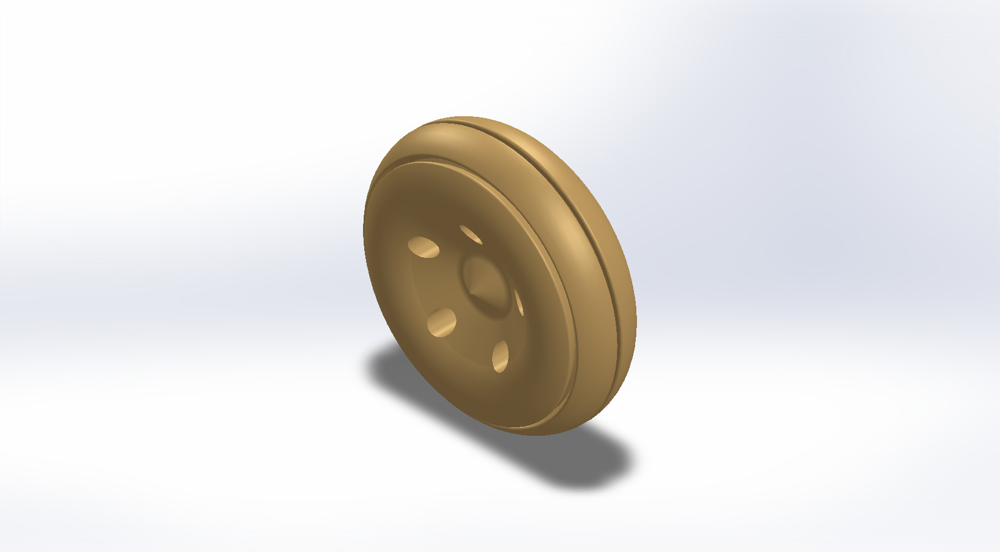
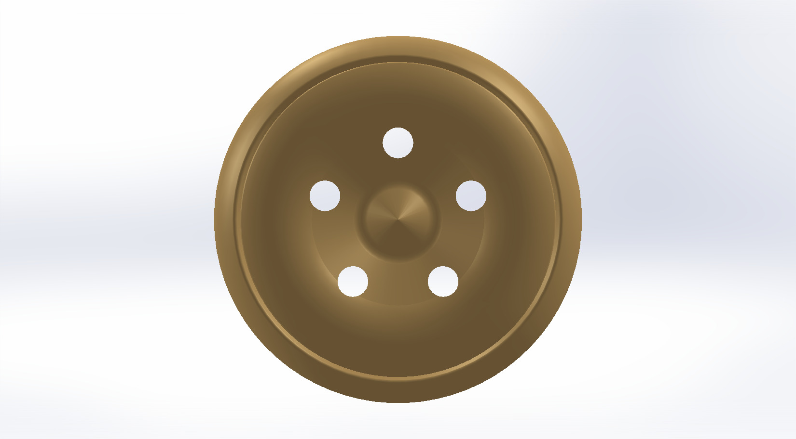
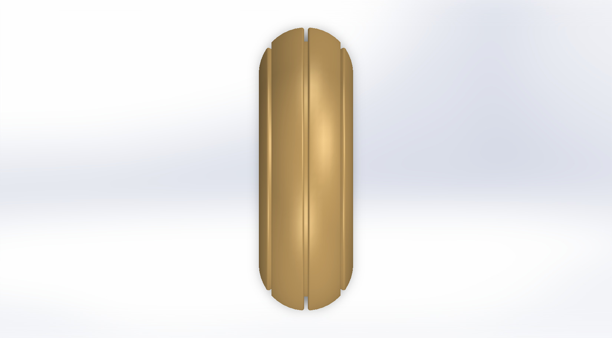
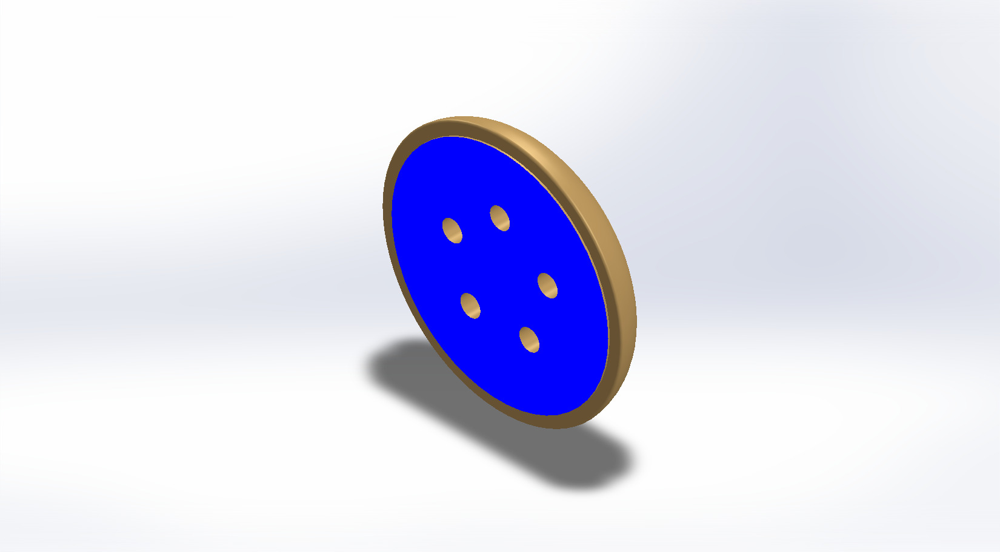
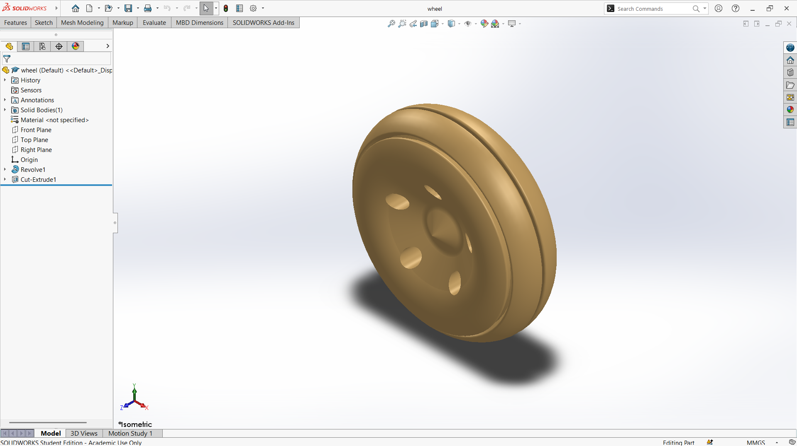

# A Grooved Solid Wheel with a Rounded Rim and a Five-Hole Disc

## Summary

The wheel is one of the most basic and important inventions in engineering. It carries loads, reduces friction, and turns rotation into movement, and it is found in nearly every machine that rolls. This project explores how a simple wheel can be modeled computationally, from its rim to its hub.

The model is a solid wheel with a smooth, rounded rim that works like a tire tread. A narrow groove runs around the outer surface of the rim and divides it visually. The central disc is slightly recessed and has five holes arranged evenly around a raised hub in the middle, which reduce weight and give the wheel a recognizable look. The main challenge was to blend the curved rim into the flat disc smoothly and to place the five holes at equal spacing around the center.

The wheel was developed as a computational model in SolidWorks. The views below show the rim, the groove, and the disc from every side, along with a section view that shows how the profile is built. This prototype is a base concept design that can be developed further into a wheel with a defined tire, bearing, and axle. Defining the wheel size and load rating properly is an important step before it can be used on a real vehicle.

---

## Computational Design

|   View    |                       Image                        |
| :-------: | :------------------------------------------------: |
| Isometric |  |
|   Left    |            |
|   Right   |          |
|   Back    |            |
|   Front   |          |
|    Top    |              |
|  Bottom   |        |
|  Section  |      |

---

## Software Used

| Purpose |               Name                |
| :-----: | :-------------------------------: |
| Design  | SolidWorks 2024 (Student Version) |

---

## Feature Tree

| No  |    Name     |
| :-: | :---------: |
| 01  |   Revolve   |
| 02  | Cut Extrude |

---

## Feature Tree Image

---

## Applications [^1][^2]

- Automobiles and Trucks
- Rail Vehicles and Cranes
- Forklifts and Industrial Material Handling
- Agricultural Machinery
- Aerospace Ground Support and Landing Gear
- Robotics and Unmanned Ground Vehicles

---

## Design Limitations

The design of the wheel was developed as a prototype product. That’s why the real-life design considerations, including tire and bearing selection, material selection, load and fatigue analysis, balancing, mounting standards, proper design specification, monetization, and feasibility, have not been included.

---

## Future Improvements

The wheel was modeled as geometry only. Hub, spokes or disc, and rim dimensions should be matched to a real tire and bearing size, with a bore, keyway, or bolt pattern for mounting. Material selection (such as cast aluminum or steel) and finite element analysis of radial, lateral, and impact loads are required to size the structure. Weight optimization and fatigue life estimation would then improve the design.

---

## Acknowledgements

Special thanks to the [EasyCAD Solutions](https://www.youtube.com/@EasyCADSolutions) YouTube channel for the SolidWorks tutorials that helped in creating this design. I would also like to thank the [CAD CAM Tutorials](https://www.youtube.com/c/CADCAMTutorials) YouTube channel for its tutorials and learning resources, and [Mr. Md. Abdus Salam](https://mpe.iutoic-dhaka.edu/profile/salam/education), Drafting Instructor, Department of Mechanical and Production Engineering, Islamic University of Technology, for his guidance and support, and for his assistance in our ME 4210 3D Solid Modeling and Assembling lab course.

---

## References

[^1]: [Wheels](https://technav.ieee.org/topic/wheels/)

[^2]: [Industrial wheels for internal transport in the automotive industry](https://scidar.kg.ac.rs/handle/123456789/22137)
